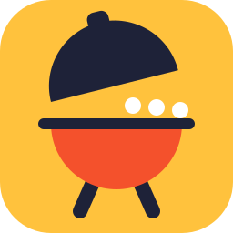
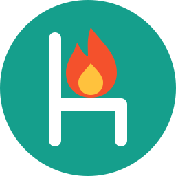

# grill-room icon proposals

Palette: ember `#F4512C`, butter `#FFC23D`, teal `#159F8C`, ink `#1E2238`, white.
Each icon uses at most three colors plus ink or white.

 Speech bubble seared with three grill marks.
 Kettle grill with its lid open, chatting.
 Top view of a table, five seats, one shared page.
 A document catching the heat of the discussion.
 Voice waveform turning into lines of text.
 Microphone whose mesh is a grill grate.
 Highlighted line with a comment bubble in the margin.
 Debate thermometer, needle pushed into the hot zone.
 G and R sharing one stroke, drawn as paths.
 Ideas threaded on a skewer, ready for the fire.
 Two voices overlap; the overlap is where it sizzles.
 Slotted spatula flipping a page to its next revision.
 A chair with a flame on it: the hot seat.
 Stack of revisions, the latest one seared.
 Open door into a warm room where people talk.
 Round grill grate whose bars double as audio levels.
 Tongs picking up a speech bubble.
 Campfire whose smoke rises as speech bubbles.
 Opening quote marks shaped like two flames.
 A room, literally, with grill marks on it.

## Favicon size check

    
    
    
    

Weakest at 16px: 07, 12, 14 and 17. Their fine details merge into one blob.

## Top 3

1. **01 grill-bubble.** Talk plus grill in one shape, and it still reads at 16px.
2. **19 quote-flames.** Two shapes, no detail to lose, and it carries a double meaning.
3. **02 talking-kettle.** The friendliest one, a cartoon grill that a PM would smile at.
