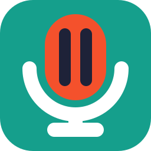
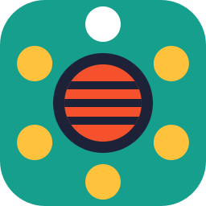
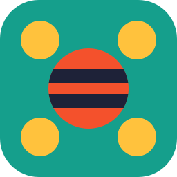
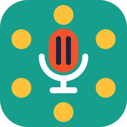

# grill-room icons, round 2

Same palette and constraints as round 1: ember `#F4512C`, butter `#FFC23D`, teal `#159F8C`, ink `#1E2238`, white.

## Gallery

 01-a. Bigger bubble, curved tail, thicker marks.
 01-b. Round bubble, tail to the right, on butter.
 01-c. Marks cut out of the bubble, tile shows through.
 01-d. No tile, cut-out marks, works on any background.
 06-a. Mic head is a kettle grill, the stand is its leg.
 06-b. Grill-bar mic flanked by a waveform made of bars.
 06-c. Two bars, thick strokes, built for 16px.
 06-d. No tile, slits cut into the head, teal stand.
 03-a. Weber from above, six people around, one speaking.
 03-b. Three-quarter kettle, three people standing behind it.
 03-c. Closed kettle whose smoke becomes a speech bubble.
 03-d. Favicon cut: grate disc, four big dots.
 hy-a. Speech bubble that is a kettle: lid handle, legs, tail.
 hy-b. Grill mic in the middle of the circle.

## Favicon size check

             

             

Weakest at 16px: 03-b and hy-a, the legs and heads turn to noise. 06-d's three slits merge into one stripe.
01-a sits on an ink tile that almost vanishes on dark UIs; 01-c and 01-d don't have that problem.

## Top 3

1. **03-a top-view.** The Weber joke done straight. The room is literally people around a grill.
2. **01-c negative-marks.** Keeps everything people liked about 01, and the cut-outs work on any tile color.
3. **06-c simple-16.** Most legible at 16px of the whole round. Use it for the favicon.
