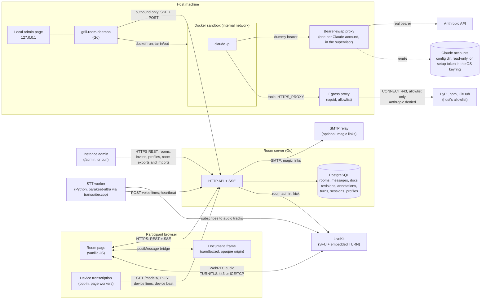

# Architecture

Who talks to whom, and over what.

## Interfaces, TL;DR

| Component | Exposes | Talks to | Auth |
|---|---|---|---|
| Instance admin | nothing | room server: `GET/POST /api/rooms`, `PATCH/DELETE /api/rooms/{room}`, `GET/POST/DELETE .../invites`, `GET/DELETE /api/profiles`, `GET/DELETE /api/templates`, `GET/DELETE /api/skills`, and `/admin` with its `/api/admin/*` routes | admin token (one per server), or an `/admin` session |
| Room admin | nothing | room server: rename, invites, room admins, overview and delete of their room, from the room page | profile cookie of a profile in `room_admins` |
| Room page | nothing | room server (REST + SSE), LiveKit (WebRTC), document iframe (postMessage, validated); with device transcription on, `/models/`, `/voice/device-lines` and the device beat on `/presence` from its workers | room cookie, or the profile cookie |
| Profile page | nothing | room server: `/api/profile/*` | profile cookie; recovery or emailed link token |
| Script or agent of a profile | nothing | room server: the REST routes its profile reaches, never `/api/admin/*`, admin-only or credential routes; `/mcp`, whose tools call those routes with the same token | personal API token (`grt_`), read or full |
| Document iframe | anchors and selections via postMessage | room page only | none: opaque origin, CSP sandbox, no cookie |
| Room server | `/api/*` REST, `/api/rooms/{room}/events` SSE, `/mcp` (MCP, Streamable HTTP), `/install.sh`, `/download/*`, `/healthz`; `/metrics` on its own port; `grill_room_db_lock_wait_seconds` there is how long a write waited for its write slot and the global write lock | PostgreSQL, LiveKit server API, SMTP relay when configured | admin token, participant token or cookie, profile cookie, personal API token, daemon token, STT token, pairing secret |
| LiveKit | WebRTC signalling (WSS), TURN/TLS on 443, ICE/TCP | browsers, STT worker | 1 min JWT minted by the room server |
| STT worker | `/healthz`, `/metrics` | LiveKit (hidden participant), room server (`/api/stt/heartbeat`, whose answer names the tracks to skip, `/voice/lines`, `/voice/dropped`), its own engine processes over pipes | STT token; LiveKit key pair |
| Daemon: a supervisor and one worker per room server, [protocol](daemon-protocol.md) | local admin page on 127.0.0.1: instances, rooms, Claude accounts, global and per-instance settings, and the turn history in a local `monitor.db`; a local socket (named pipe on Windows) for a second launch to hand over its room | room server (SSE `daemon/events` with turns and whether it hosts, turn job, workspace manifest and tar, session, result, status with the host cap and approval mode), Docker, `/api/daemon/version` and `/download/` for each worker's binary and its sigstore bundle, GitHub releases (or an instance) for the supervisor's own update, the sigstore TUF repository for the trusted root | daemon token from pairing; admin page one-time link + Origin check |
| Bearer-swap proxy | HTTP on the Docker bridge, one per account, in the supervisor | Anthropic API | swaps a worker's dummy bearer for the account's real token on Claude Code's model calls only, since the sandbox can read the dummy bearer; counts each worker's requests and refuses a cut-off one |
| Egress proxy (squid) | HTTP proxy on the sandbox network only | the host's allowlisted domains, or any public name under "Allow every website", `CONNECT` to 443; Anthropic's hosts and link-local addresses denied | none; the allowlist and the switches are the control |
| Sandbox | nothing | the bearer-swap proxy, the egress proxy, nothing else | dummy credentials only |

## STT capacity and metrics, TL;DR

- One STT pod joins every room with audio. Its two parakeet engine processes (2 threads each) keep up with about four people talking at once across the instance (spike S10d: 8.4x real time on a 4-vCPU lab node). That is the ceiling until rooms are spread over several pods.
- Past it, utterances wait in one queue of 64 (`APP_QUEUE_SIZE`). An engine takes the oldest utterance whose speaker has none in an engine, so each speaker's lines post in order.
- An utterance that waited over 10 s logs `queue_wait_slow`, and the alert `GrillSTTQueueWaitOver10s` fires (`deploy/monitoring/stt.yaml`). On another Prometheus: `sum(increase(grill_stt_queue_wait_seconds_count[5m])) - sum(increase(grill_stt_queue_wait_seconds_bucket{le="10.0"}[5m])) > 0`.
- A full queue drops the new utterance, never silently. The room gets "Transcription overloaded: one line lost for <name>.", once per speaker per 30 s.
- An engine process that dies or hangs past `APP_ENGINE_TIMEOUT_S` loses its utterance (an `error`) and is restarted. `/healthz` fails once no engine has been up for 60 s.

| Metric | What it says |
|---|---|
| `grill_stt_engine_info{engine,model,revision}` | the running engine and model |
| `grill_stt_queue_depth` | utterances waiting for an engine |
| `grill_stt_queue_wait_seconds` | from the VAD cut to an engine taking the utterance |
| `grill_stt_engines_busy` | engine processes transcribing now; at `APP_ENGINE_PROCESSES` for long, the pod is saturated |
| `grill_stt_transcribe_seconds{engine}` | model time per utterance |
| `grill_stt_line_latency_seconds{engine}` | end of speech to the line stored in the room |
| `grill_stt_utterances_dropped_total` | utterances a full queue dropped |
| `grill_stt_lines_total{result}`, `grill_stt_lines_implausible_total{reason}` | outcome per utterance |
| `grill_stt_lines_language_total{engine,guess}` | stored lines by guessed language: the English leak |

## On-device transcription, TL;DR

A participant on a capable desktop may tick "Transcribe on this device" (spec 010). Their browser then transcribes their own microphone and the worker skips their track.

- Lines: the page posts each utterance to `POST /api/rooms/{room}/voice/device-lines` with its session. The server stores it as a voice line from the session's participant with `source=device`; worker lines get `source=server`. Both count for voice triggers.
- Handover:
  1. The page's transcription worker sends `{"tab", "device_stt": true}` to `/presence` every 1 s while device mode is on and the mic is tapped or muted, one beat at a time. It touches no presence or audio state.
  2. The server holds a per-participant device flag while any of their tabs beat in the last 3 s.
  3. The worker heartbeats every 2 s. The answer lists the flagged participants of the rooms it named: `{"device": {"<room>": [ids]}}`.
  4. The worker stays subscribed to a flagged track and discards its audio.
  5. `device_stt: false` (toggle off, fallback) or a `gone` beat (tab closed) drops the flag at once, so the worker resumes within one heartbeat. A crashed or frozen page or a dead mic tap stops the beats: the flag lapses after 3 s and the worker resumes within about 5 s.
- Dedupe: around a handover both sides may transcribe one utterance. A line is dropped, answered `200 {"deduped": true}`, when the same participant has a line from the other source stored in the last 5 s at 0.8 similarity or more (Levenshtein over lowercase letters and digits, accents dropped). Lines from one source are never dropped.
- The flag lives in the `presence` table every pod reads. The repeat check and the insert run in one transaction (`PostVoiceLine`), so one utterance posted to two pods at once is stored once.

| Metric (room server) | What it says |
|---|---|
| `grill_room_device_stt_participants` | participants whose device transcribes them now; the leader's value, 0 on the other pods |
| `grill_room_voice_lines_total{source}` | voice lines stored, `device` or `server` |
| `grill_room_voice_lines_deduped_total{source}` | lines dropped as a repeat of the other source's, by the dropped line's source |

## Persona voices, TL;DR

A persona with "Speaks in the call" on says a short line in the LiveKit call after its turn (spec 013).

- What: its `spoken.md`, sanitised and cut at a sentence end by the room server, or a summary of its actions (`internal/web/speech.go`). Never the chat text or a document. No log carries the words.
- Flow: the room server queues the line in the `tts_lines` table; the `tts` pod reads `GET /api/tts/events` with its own token (`GRILL_ROOM_TTS_TOKEN`), resumes after `Last-Event-ID`, and heartbeats states back every 2 s. A line no pod took within its budget is dropped as `no_service`: the room's queue maximum (40 s by default), or 120 s when it was queued with no pod up (Scale to zero).
- Bots: one LiveKit participant per speaking persona, identity `persona-<id>`, kind `agent`, while a human is in the call and not deafened; it leaves 60 s after. It subscribes to the humans' audio, without which LiveKit never names them as speakers (S14). Its own onset detector on each human track stops the persona; during a track's first 4 s of persona audio it wants 9 loud 10 ms frames in 160 ms instead of 4 in 60 ms, so the echo canceller's warm-up leak does not cut the persona (S16). The STT worker never subscribes to an agent and leaves a room where only agents remain.
- Engine: Pocket TTS 3.3.0, French and English models in one process; a rule-based text layer reads numbers, acronyms and English tech words in each sentence's language (S14b). The audio chain levels each voice, shortens pauses to 300 ms, applies the persona's rate without changing its pitch, and doubles 24 kHz to 48 kHz.
- Lexicon: how the voices say a term, English- or French-style, in the `pronunciations` table. A migration inserts the seed once (`internal/voices/lexicon_seed.json`, byte-equal to the pod's copy by a test); the admin edits it in `/admin` Pronunciation. The stream sends the whole lexicon as a `lexicon` event at connect and on each change; the pod speaks with its seed copy until then. `make tts-lexcheck` (CI job `lexicon`, 013-AC33) has each seed entry said 10 times and heard back by the STT image at least 6 times; the job fails when more than 5 entries miss.
- Sizing: one synthesis takes one torch thread at RTF 0.47 (S14, workstation E-cores), so 2 CPUs speak two rooms at once. Two threads under a 2-CPU limit starved LiveKit's media threads and left gaps; one does not.
- Pace: on the lab's 4-CPU nodes (i7-6700) Pocket runs at RTF 0.6 to 0.7 with one thread on a quiet node, 1.0 to 1.6 when its neighbours load it, and worse with two threads (1.0 to 1.15). With kubecost removed from the cluster (2026-10-18), one thread renders at RTF 0.47 to 0.54 (French model, estelle and cml-2114, in the pod's own cgroup). The player learns the pod's RTF and characters-per-second from the sentences it made and holds each sentence until enough is made to play it to its end: a slow pod delays a sentence, it never stutters inside one. A human still stops it at once.
- Scale to zero (013-AC34, opt-in `make k8s-autoscale`): KEDA scales `tts` between 0 and 1 on `grill_room_tts_demand`, the rooms with a speaking persona that a human has open, in the audio or not, and back to 0 10 min after the last demand. Cold start on the lab (v0.0.38, image cached on the node), when it still started on joining the audio: 77 s from the first human joining the audio to the persona's bot in the call, 46 s of it for the demand to reach KEDA through the scrape and its 10 s poll and 31 s for the pod (17.6 s loading the models); a node without the image adds about 30 s to pull its 950 MB. On v0.0.39 (2026-10-18) the pod took 25 s from KEDA's scale-up to its stream (12.5 s loading the models): with the demand's path to KEDA, a room opened reaches a connected pod in about 70 s. A line queued while no pod is up (no stream, or no heartbeat within 8 s) waits 120 s for one (or the room's queue maximum, when longer) before it is dropped `no_service`; behind speech on a running pod it keeps the room's maximum.

| Metric | What it says |
|---|---|
| `grill_room_tts_lines_queued_total` (room server) | lines personas were to say |
| `grill_room_tts_lines_dropped_total{reason="no_service"}` (room server) | lines no pod took in time |
| `grill_room_tts_pod_up` (room server) | 1 while the pod heartbeats; the leader's value, 0 on the other room server pods |
| `grill_room_tts_demand` (room server) | rooms with a speaking persona and a human who has the room open: what KEDA scales the pod on, with `max` over the pods; the leader's value, 0 on the others |
| `grill_tts_lines_received_total`, `grill_tts_lines_spoken_total` | lines taken, lines said to their end |
| `grill_tts_lines_interrupted_total`, `grill_tts_lines_resumed_total` | humans cutting a persona off, and lines picked up again |
| `grill_tts_lines_dropped_total{reason}` | `interrupted`, `stale`, `no_listener`, `no_service`, `error` |
| `grill_tts_queue_wait_seconds` | a line's arrival to its start |
| `grill_tts_first_audio_seconds` | a line's arrival to its first frame on the track |
| `grill_tts_stop_seconds` | LiveKit naming a human speaker to the persona's audio cleared |
| `grill_tts_synthesis_rtf` | synthesis time over audio time, per span |
| `grill_tts_underruns_total` | gaps over 100 ms inside a sentence: synthesis fell behind |
| `grill_tts_bots`, `grill_tts_bots_joined_total` | bots in a call now, and bots that joined |

## Storage, TL;DR

- One PostgreSQL 16+ database with `C` collation holds everything the room server stores (`internal/store`, spec 017). The server refuses another collation. It connects straight to the primary: no pooler, as the advisory lock is per session.
- Schema: the `schema_version` table holds the version. On an empty database the first start creates the baseline (46, the last SQLite schema) and runs the migrations past it, all under the write lock, so pods starting together make one schema.
- Writes: each write transaction takes `pg_advisory_xact_lock` on one key, so one write commits at a time across every pod, and ids commit in id order for the `id > last` stream cursors. In a pod, one write at a time holds a pool connection, leaving the others to reads. A wait longer than `lock_timeout` (30 s) fails the write; `grill_room_db_lock_wait_seconds` measures the wait. Writes to the shared-state tables (below) skip this lock and its metric, since no id cursor reads them; a `rate_events` insert takes an advisory lock on its own key instead. PostgreSQL may abort one of two such writes as a deadlock: it runs again, up to 3 times.
- Reads run without the lock; an export reads its room from one read-only snapshot.
- Exports and imports stage files in `GRILL_ROOM_STAGING_DIR`, the pod's own disk.
- `grill-room db copy` and `db verify` move a SQLite database of before spec 017 into an empty PostgreSQL one and compare them table by table; the copy holds the write lock (README, Copying a SQLite database).

| Metric (room server) | What it says |
|---|---|
| `grill_room_db_lock_wait_seconds` | how long a write waited for its writer slot and the global write lock (017-AC20) |
| `grill_room_bus_dropped_total` | room change signals lost to a full subscriber; the stream catches up at its heartbeat |
| `grill_room_notify_sent_total` | room change notifications sent to the other pods (017-AC20) |
| `grill_room_notify_received_total` | room change notifications received from the other pods (017-AC20) |
| `grill_room_listen_reconnects_total` | `LISTEN` connections started again after the first (017-AC20) |
| `grill_room_listen_errors_total` | `LISTEN` connections that failed or ended, each logged `listen_failed` (017-AC20) |
| `grill_room_event_streams` | open SSE event streams |
| `grill_room_stt_workers` | STT workers with a recent heartbeat; the leader's value, 0 on the other pods |
| `grill_room_leader` | 1 on the pod that holds the leader lock, 0 on the others (017-AC17) |
| `grill_room_workspace_fallbacks_total{reason}` | full workspace fetches by daemons that keep a cache |
| `grill_room_mcp_tool_calls_total{tool,result}` | MCP tool calls: `ok`, `error` or `server_error` |
| `grill_room_turn_conflicts_total{outcome}` | turn results rejected on a document conflict: `rerun` or `failed` |

## Shared state, TL;DR

Since spec 017 Phase 3 nothing a request needs lives in one pod's memory: any pod answers any request.

- Wake-ups: the bus wakes the pod's own streams and sends `NOTIFY` on one channel, payload `<pod> <room>`. Every pod `LISTEN`s, drops its own notifications and wakes that room's streams, which re-read the database. When its `LISTEN` connection comes back, a pod wakes every stream with `*` (`bus.All`). Ids starting with `:` name no room: `:tts` (a line queued) and `:lexicon` wake the TTS streams, and the Web Push loop skips them.
- `UNLOGGED` tables with an expiry hold what lives seconds to minutes: `daemon_connections` (one row per open app stream, renewed, 1 minute lease), `daemon_status` (what the app last reported), `presence` (tabs, their audio state, device transcription), `stt_workers` (heartbeats), `tts_pod` (the TTS pod's one row) and `pairings`. They skip the WAL, so a PostgreSQL crash empties them; apps, tabs and workers write them again on their next beat. Every pod sweeps them each minute: expired rows (`presence` in batches of 1000, in key order), and `daemon_status` rows left with no connection. A daemon whose last connection lapsed there takes the disconnect path: a turn it hosted fails and the room elects a host.
- Logged tables: `tts_lines`, on one sequence, so the TTS pod's `Last-Event-ID` resumes on any pod; `rate_events` for the magic link and login limits; `rooms.host_moved_line`, the banner a previous host sees (009-AC34).
- Per-room locks: a session advisory lock `(kind, room)` on a pinned connection, held across several transactions. Presses, queue drains and automatic triggers try the room's turn lock under the pod's `turnMu`. When another pod holds it, they wait outside `turnMu`, behind a per-room guard on the pod: at most one connection per room waits pinned, however many presses queue behind it. A plugin fetch tries the room's plugin lock and answers 409 when another pod holds it (009-AC8). A host hand-over checks in its own transaction that the host did not move meanwhile and that the new host has a live app.
- Pairing: the participant's approval marks the request approved; the app's poll then mints the daemon token, stores its hash and returns it once. The pairing secret only authenticates the poll.
- Per-pod cache: streams poll presence, STT workers and the TTS pod's row. A pod reads each at most once a second and serves all its streams from that copy; its own presence write drops the room's copy. Another pod's change shows within that second.
- Still per pod: open streams, the upload, archive and plugin fetch slots, the staging directory, the counters behind the metrics.
- Leader (Phase 4): one pod holds a session `pg_try_advisory_lock(8, 0)` on a connection of its own, named `grill-room-leader <pod>` in `pg_stat_activity`. The others try it every 5 s; the leader pings its session every 5 s and stops its loops as soon as a ping fails. A killed lock session moves the leadership within 5 s, and the old leader stops its loops within 5 s too: during that overlap both run them, and a push may go twice. The session has `idle_session_timeout` 15 s (3 pings), so a leader cut off without a FIN loses the lock within 15 s, and a follower takes it within 20 s. `grill_room_leader` says which pod leads.
- The leader alone runs the loops: the audit and client purge (daily), the empty profile purge (hourly), the timer and notes-watch triggers, Web Push, and the turn sweeper. They stop when it loses the lock and start on the pod that takes it. The leader alone computes `grill_room_stt_workers`, `grill_room_device_stt_participants`, `grill_room_tts_pod_up` and `grill_room_tts_demand`; the others export 0, so `max` and `sum` over the pods agree.
- Web Push reads every room's lines past a cursor, `settings('push_cursor')`, on each room signal. The leader writes it on its first tick and whenever it moves, kept before any batch pending or in flight, and the next leader starts there. A leader that dies mid-send leaves the cursor before that batch: the next one sends it again.
- Turn sweeper, every 10 s: it fails a running turn whose app holds no live connection on any pod (`daemon_connections`), and one that has run past the turn timeout plus one minute since it left the app's queue. A pod's start fails no turn. An app holds one stream per room and drops its running turns with it. A stream marks a turn `turns.delivered` just before it writes it to the app, and ends without writing it when the mark fails, so the disconnect cleanup fails the turn. When the app opens a stream, on any pod, its delivered turns still running fail there: the cleanup a dead pod could not run. A running turn no stream wrote (pressed while a dead pod's row still counted the app connected) is announced on the new stream and runs. The rule is that a turn may fail but never hang: the app takes a turn id once, so a turn it may hold must not wait to be announced again. Known limits: a turn written to a stream the app no longer reads (half-open), or marked by a pod killed before the write, fails when the app reconnects, and the user presses again.
- Follow-up: the app could release an id whose job fetch a stream drop cancelled, so a re-announced turn runs instead of failing. A stopping pod ends its app streams at once, within its 2 s drain, and runs their disconnect path: the app drops a running turn with its stream, so the turn fails then, as on one pod. Failing a turn only acts on a running turn, so the sweeper, the lease janitor and an app's own disconnect post one line between them. A turn whose app vanished with its pod fails at the first sweep after the app's lease lapses: within 70 s of the app's last renewal (1 minute lease, 10 s sweep), under the shortest turn timeout plus 30 s (017-AC18).
- Follow-up: a turn surviving a rollout needs the app to run it past its stream and post the result after it reconnects; until then a pod stop fails the turns of the apps streaming from it.
- `make e2e-twopod` runs two servers on one database, a browser on each (017-AC10, 017-AC11).

| Deploy (`deploy/k8s/room.yaml`) | Setting |
|---|---|
| Replicas | 2, `RollingUpdate` with `maxUnavailable: 0`, `maxSurge: 1` |
| Disruptions | PodDisruptionBudget `minAvailable: 1`: a node drain keeps one pod |
| Placement | spread over nodes, preferred, not required |
| Affinity | none: the Service and the ingress pick any pod (Q8) |
| Disks | per pod, `emptyDir`: staging 2.5 GiB, `/tmp` 256 MiB, model files 1 GiB |
| Shutdown | `preStop` sleeps 5 s, then SIGTERM closes the listener, POSTs get 2 s, then mail sends up to 30 s; grace 45 s ([rollout.md](rollout.md)) |
| Check | `make rollout-watch` during a rollout or a pod loss (017-AC19, 017-AC21) |

## A turn, end to end

1. A participant presses a persona's button: `POST /api/rooms/{room}/turns`. While another turn runs, the press waits in the room's queue.
2. The server stores the turn, its prompt and the persona's text, model and effort, then pushes `turn` on the host daemon's SSE.
3. The daemon fetches the job, the workspace and, if needed, the session jsonl. For the workspace it fetches a manifest of paths and sha256, then a tar of only the files its per-room cache lacks. With no cache for the room, or a cached file that fails its hash, it fetches the full tar.
4. It runs `claude -p` in the sandbox, which reaches Anthropic only through the proxy of the room's account.
5. It posts back the changed files, the synthesis and the session bytes added.
6. The server applies the result atomically: revisions, agent message, thread replies, new annotations. Then it notifies every open SSE stream.

[agent-workspace.md](agent-workspace.md) has the workspace layout and the prompt contract.
