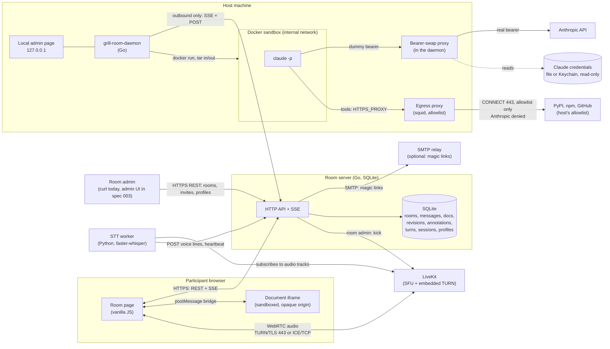

# Architecture

Who talks to whom, and over what.

## Interfaces, TL;DR

| Component | Exposes | Talks to | Auth |
|---|---|---|---|
| Room admin | nothing | room server: `GET/POST /api/rooms`, `PATCH/DELETE /api/rooms/{room}`, `GET/POST/DELETE .../invites`, `GET/DELETE /api/profiles`, `GET/DELETE /api/templates`, `GET/DELETE /api/skills` | admin token (one per server) |
| Room page | nothing | room server (REST + SSE), LiveKit (WebRTC), document iframe (postMessage, validated) | room cookie, or the profile cookie |
| Profile page | nothing | room server: `/api/profile/*` | profile cookie; recovery or emailed link token |
| Document iframe | anchors and selections via postMessage | room page only | none: opaque origin, CSP sandbox, no cookie |
| Room server | `/api/*` REST, `/api/rooms/{room}/events` SSE, `/install.sh`, `/download/*`, `/healthz`; `/metrics` on its own port | SQLite, LiveKit server API, SMTP relay when configured | admin token, participant token or cookie, profile cookie, daemon token, STT token, pairing secret |
| LiveKit | WebRTC signalling (WSS), TURN/TLS on 443, ICE/TCP | browsers, STT worker | 5 min JWT minted by the room server |
| STT worker | `/metrics` | LiveKit (hidden participant), room server (`/api/stt/heartbeat`, `/voice/lines`) | STT token; LiveKit key pair |
| Daemon: a supervisor and one worker per room server, [protocol](daemon-protocol.md) | local admin page on 127.0.0.1, with the host cap, approval mode and egress allowlist; a local socket (named pipe on Windows) for a second launch to hand over its room | room server (SSE `daemon/events`, turn job, workspace manifest and tar, session, result, status with the host cap and approval mode), Docker, `/api/daemon/version` for self-update | daemon token from pairing; admin page one-time link + Origin check |
| Bearer-swap proxy | HTTP on the Docker bridge, sandbox network only | Anthropic API | swaps the sandbox's dummy bearer for the host's real token |
| Egress proxy (squid) | HTTP proxy on the sandbox network only | the host's allowlisted domains, `CONNECT` to 443; Anthropic's hosts denied | none; the allowlist is the control |
| Sandbox | nothing | the bearer-swap proxy, the egress proxy, nothing else | dummy credentials only |

## A turn, end to end

1. A participant presses a persona's button: `POST /api/rooms/{room}/turns`. While another turn runs, the press waits in the room's queue.
2. The server stores the turn, its prompt and the persona's text, model and effort, then pushes `turn` on the host daemon's SSE.
3. The daemon fetches the job, the workspace and, if needed, the session jsonl. For the workspace it fetches a manifest of paths and sha256, then a tar of only the files its per-room cache lacks. With no cache for the room, or a cached file that fails its hash, it fetches the full tar.
4. It runs `claude -p` in the sandbox, which reaches Anthropic only through the proxy.
5. It posts back the changed files, the synthesis and the session bytes added.
6. The server applies the result atomically: revisions, agent message, thread replies, new annotations. Then it notifies every open SSE stream.

[agent-workspace.md](agent-workspace.md) has the workspace layout and the prompt contract.
