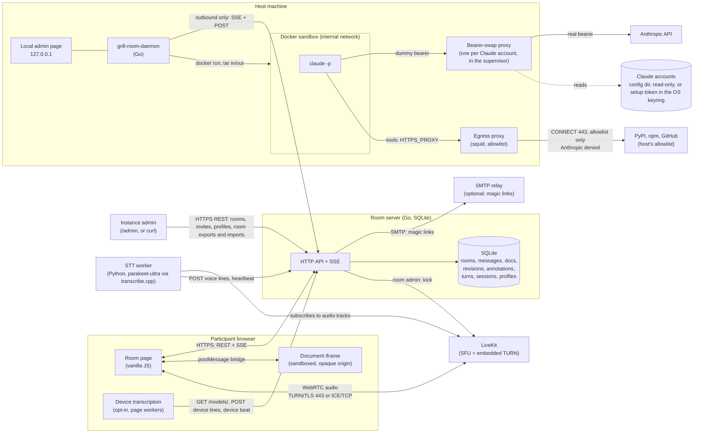

# Architecture

Who talks to whom, and over what.

## Interfaces, TL;DR

| Component | Exposes | Talks to | Auth |
|---|---|---|---|
| Instance admin | nothing | room server: `GET/POST /api/rooms`, `PATCH/DELETE /api/rooms/{room}`, `GET/POST/DELETE .../invites`, `GET/DELETE /api/profiles`, `GET/DELETE /api/templates`, `GET/DELETE /api/skills`, and `/admin` with its `/api/admin/*` routes | admin token (one per server), or an `/admin` session |
| Room admin | nothing | room server: rename, invites, room admins, overview and delete of their room, from the room page | profile cookie of a profile in `room_admins` |
| Room page | nothing | room server (REST + SSE), LiveKit (WebRTC), document iframe (postMessage, validated); with device transcription on, `/models/`, `/voice/device-lines` and the device beat on `/presence` from its workers | room cookie, or the profile cookie |
| Profile page | nothing | room server: `/api/profile/*` | profile cookie; recovery or emailed link token |
| Script or agent of a profile | nothing | room server: the REST routes its profile reaches, never `/api/admin/*`, admin-only or credential routes; `/mcp`, whose tools call those routes with the same token | personal API token (`grt_`), read or full |
| Document iframe | anchors and selections via postMessage | room page only | none: opaque origin, CSP sandbox, no cookie |
| Room server | `/api/*` REST, `/api/rooms/{room}/events` SSE, `/mcp` (MCP, Streamable HTTP), `/install.sh`, `/download/*`, `/healthz`; `/metrics` on its own port | SQLite, LiveKit server API, SMTP relay when configured | admin token, participant token or cookie, profile cookie, personal API token, daemon token, STT token, pairing secret |
| LiveKit | WebRTC signalling (WSS), TURN/TLS on 443, ICE/TCP | browsers, STT worker | 5 min JWT minted by the room server |
| STT worker | `/healthz`, `/metrics` | LiveKit (hidden participant), room server (`/api/stt/heartbeat`, whose answer names the tracks to skip, `/voice/lines`, `/voice/dropped`), its own engine processes over pipes | STT token; LiveKit key pair |
| Daemon: a supervisor and one worker per room server, [protocol](daemon-protocol.md) | local admin page on 127.0.0.1: instances, rooms, Claude accounts, global and per-instance settings, and the turn history in a local `monitor.db`; a local socket (named pipe on Windows) for a second launch to hand over its room | room server (SSE `daemon/events` with turns and whether it hosts, turn job, workspace manifest and tar, session, result, status with the host cap and approval mode), Docker, `/api/daemon/version` and `/download/` for each worker's binary and its sigstore bundle, GitHub releases (or an instance) for the supervisor's own update, the sigstore TUF repository for the trusted root | daemon token from pairing; admin page one-time link + Origin check |
| Bearer-swap proxy | HTTP on the Docker bridge, one per account, in the supervisor | Anthropic API | swaps a worker's dummy bearer for the account's real token on Claude Code's model calls only, since the sandbox can read the dummy bearer; counts each worker's requests and refuses a cut-off one |
| Egress proxy (squid) | HTTP proxy on the sandbox network only | the host's allowlisted domains, or any public name under "Allow every website", `CONNECT` to 443; Anthropic's hosts and link-local addresses denied | none; the allowlist and the switches are the control |
| Sandbox | nothing | the bearer-swap proxy, the egress proxy, nothing else | dummy credentials only |

## STT capacity and metrics, TL;DR

- One STT pod joins every room with audio. Its two parakeet engine processes (2 threads each) keep up with about four people talking at once across the instance (spike S10d: 8.4x real time on a 4-vCPU lab node). That is the ceiling until rooms are spread over several pods.
- Past it, utterances wait in one queue of 64 (`APP_QUEUE_SIZE`). An engine takes the oldest utterance whose speaker has none in an engine, so each speaker's lines post in order.
- An utterance that waited over 10 s logs `queue_wait_slow`, and the alert `GrillSTTQueueWaitOver10s` fires (`deploy/monitoring/stt.yaml`). On another Prometheus: `sum(increase(grill_stt_queue_wait_seconds_count[5m])) - sum(increase(grill_stt_queue_wait_seconds_bucket{le="10.0"}[5m])) > 0`.
- A full queue drops the new utterance, never silently. The room gets "Transcription overloaded: one line lost for <name>.", once per speaker per 30 s.
- An engine process that dies or hangs past `APP_ENGINE_TIMEOUT_S` loses its utterance (an `error`) and is restarted. `/healthz` fails once no engine has been up for 60 s.

| Metric | What it says |
|---|---|
| `grill_stt_engine_info{engine,model,revision}` | the running engine and model |
| `grill_stt_queue_depth` | utterances waiting for an engine |
| `grill_stt_queue_wait_seconds` | from the VAD cut to an engine taking the utterance |
| `grill_stt_engines_busy` | engine processes transcribing now; at `APP_ENGINE_PROCESSES` for long, the pod is saturated |
| `grill_stt_transcribe_seconds{engine}` | model time per utterance |
| `grill_stt_line_latency_seconds{engine}` | end of speech to the line stored in the room |
| `grill_stt_utterances_dropped_total` | utterances a full queue dropped |
| `grill_stt_lines_total{result}`, `grill_stt_lines_implausible_total{reason}` | outcome per utterance |
| `grill_stt_lines_language_total{engine,guess}` | stored lines by guessed language: the English leak |

## On-device transcription, TL;DR

A participant on a capable desktop may tick "Transcribe on this device" (spec 010). Their browser then transcribes their own microphone and the worker skips their track.

- Lines: the page posts each utterance to `POST /api/rooms/{room}/voice/device-lines` with its session. The server stores it as a voice line from the session's participant with `source=device`; worker lines get `source=server`. Both count for voice triggers.
- Handover:
  1. The page's transcription worker sends `{"tab", "device_stt": true}` to `/presence` every 1 s while device mode is on and the mic is tapped or muted, one beat at a time. It touches no presence or audio state.
  2. The server holds a per-participant device flag while any of their tabs beat in the last 3 s.
  3. The worker heartbeats every 2 s. The answer lists the flagged participants of the rooms it named: `{"device": {"<room>": [ids]}}`.
  4. The worker stays subscribed to a flagged track and discards its audio.
  5. `device_stt: false` (toggle off, fallback) or a `gone` beat (tab closed) drops the flag at once, so the worker resumes within one heartbeat. A crashed or frozen page or a dead mic tap stops the beats: the flag lapses after 3 s and the worker resumes within about 5 s.
- Dedupe: around a handover both sides may transcribe one utterance. A line is dropped, answered `200 {"deduped": true}`, when the same participant has a line from the other source stored in the last 5 s at 0.8 similarity or more (Levenshtein over lowercase letters and digits, accents dropped). Lines from one source are never dropped.
- The flag and the recent lines live in the room server's memory: one replica.

| Metric (room server) | What it says |
|---|---|
| `grill_room_device_stt_participants` | participants whose device transcribes them now |
| `grill_room_voice_lines_total{source}` | voice lines stored, `device` or `server` |
| `grill_room_voice_lines_deduped_total{source}` | lines dropped as a repeat of the other source's, by the dropped line's source |

## A turn, end to end

1. A participant presses a persona's button: `POST /api/rooms/{room}/turns`. While another turn runs, the press waits in the room's queue.
2. The server stores the turn, its prompt and the persona's text, model and effort, then pushes `turn` on the host daemon's SSE.
3. The daemon fetches the job, the workspace and, if needed, the session jsonl. For the workspace it fetches a manifest of paths and sha256, then a tar of only the files its per-room cache lacks. With no cache for the room, or a cached file that fails its hash, it fetches the full tar.
4. It runs `claude -p` in the sandbox, which reaches Anthropic only through the proxy of the room's account.
5. It posts back the changed files, the synthesis and the session bytes added.
6. The server applies the result atomically: revisions, agent message, thread replies, new annotations. Then it notifies every open SSE stream.

[agent-workspace.md](agent-workspace.md) has the workspace layout and the prompt contract.
