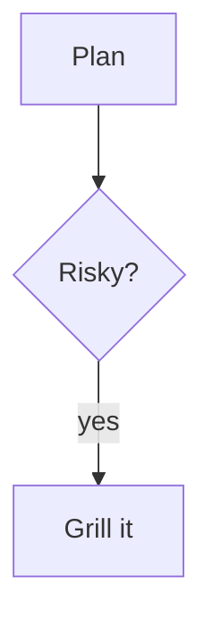

# Rollout plan

Intro with **bold**, _italic_, ~~struck~~, `code`, a link to https://example.com and :tada:.

## Table

| Step | Owner | Done |
|:-----|:-----:|-----:|
| Freeze | Alice | yes |
| Ship | Bob | no |

## Code

```go
func main() {
	fmt.Println("hello")
}
```

## Diagram



## Math

Inline $e^{i\pi} + 1 = 0$ and a block:

$$
\sum_{n=1}^{\infty} \frac{1}{n^2} = \frac{\pi^2}{6}
$$

## Lists

- [x] Spec written
- [ ] Phase 2 shipped
  1. nested ordered

> [!WARNING]
> Rollback must be tested.

A claim with a footnote.[^1]

<details><summary>Raw HTML</summary>passes through, as on GitHub.</details>

[^1]: The footnote text.
